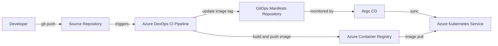

# Azure DevOps CI/CD with GitOps using Argo CD on AKS

A personal DevOps project demonstrating an end-to-end CI/CD pipeline using Azure DevOps, Docker, Azure Container Registry (ACR), Azure Kubernetes Service (AKS), and GitOps deployment with Argo CD.


> **Note:** This is a hands-on personal project built for learning and portfolio purposes.

---

## Overview

This project deploys a multi-service voting application (Python, Node.js and .NET microservices) to Azure Kubernetes Service. Application code and Kubernetes manifests are kept in separate repositories, following the GitOps pattern. Azure DevOps handles build and image publishing, while Argo CD keeps the cluster in sync with the manifests repository.

---

## Architecture



---

## Project Flow

1. A code commit triggers the Azure DevOps CI pipeline
2. The Docker image is built and pushed to Azure Container Registry
3. The CD pipeline updates the image tag in the Kubernetes manifests in the GitOps repository
4. Argo CD continuously monitors the GitOps repository
5. AKS automatically deploys the latest version

---

## Repositories

| Repository | Purpose |
|---|---|
| [voting-app-source](https://github.com/muniyappan1319/voting-app-source) | Application source code, Dockerfiles and pipeline definitions |
| [voting-app-k8s-manifests](https://github.com/muniyappan1319/voting-app-k8s-manifests) | Kubernetes manifests watched by Argo CD |

---

## Tools Used

- Azure DevOps (pipelines)
- Docker
- Azure Container Registry (ACR)
- Azure Kubernetes Service (AKS)
- Argo CD
- GitOps

---

## Prerequisites

- Azure subscription
- Azure DevOps organization and project
- Azure Container Registry
- AKS cluster
- Azure CLI and kubectl installed
- Argo CD installed on the AKS cluster

---

## Setup Overview

1. Create an Azure Container Registry and an AKS cluster
2. Attach the ACR to AKS so the cluster can pull images
3. Create a service connection in Azure DevOps for ACR
4. Configure the CI pipeline to build and push Docker images
5. Install Argo CD on the cluster
6. Create an Argo CD application pointing to the GitOps manifests repository
7. Commit a code change and verify the pipeline, the manifest update and the Argo CD sync

---

## Verification

```bash
# Check the application pods
kubectl get pods

# Check services
kubectl get svc

# Check Argo CD applications
kubectl get applications -n argocd
```

---

## Troubleshooting

- **ImagePullBackOff:** confirm the ACR is attached to AKS and the image tag exists in ACR
- **Argo CD out of sync:** check the repository URL, branch and path in the Argo CD application
- **Pipeline fails to push image:** verify the ACR service connection in Azure DevOps
- **Pods in CrashLoopBackOff:** check logs using `kubectl logs <pod-name>`

---

## Cleanup

Delete the Azure resources when finished to avoid charges:

```bash
az group delete --name <resource-group-name> --yes --no-wait
```

---

## Author

Muniyappan Ayyanar, Azure Cloud Engineer (AZ-104)

LinkedIn: https://linkedin.com/in/muniyappan-a-4937b8201
GitHub: https://github.com/muniyappan1319
